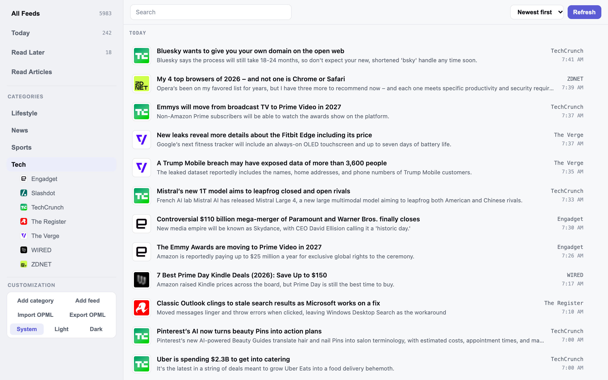
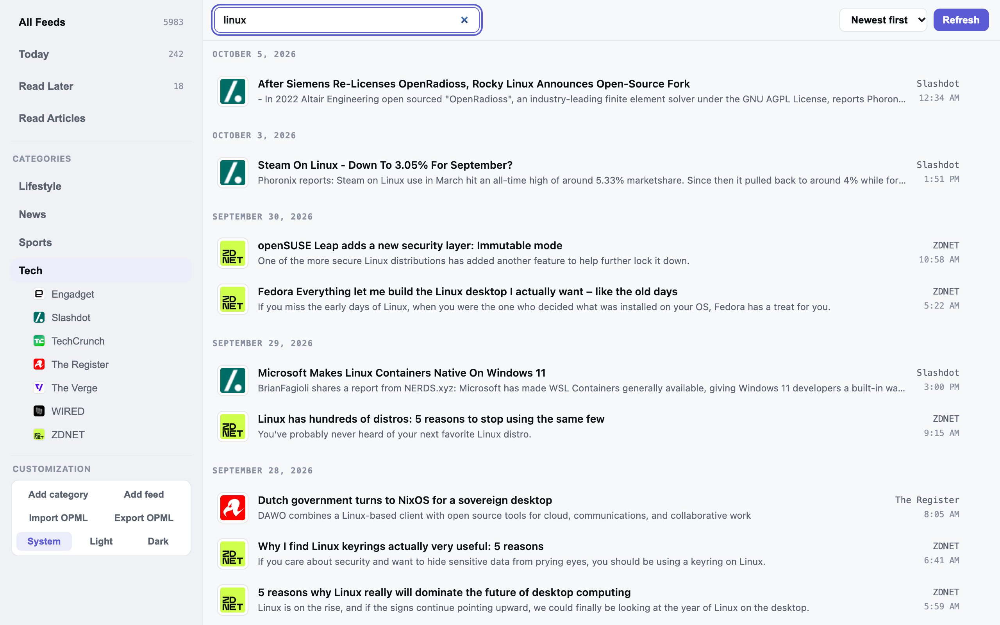
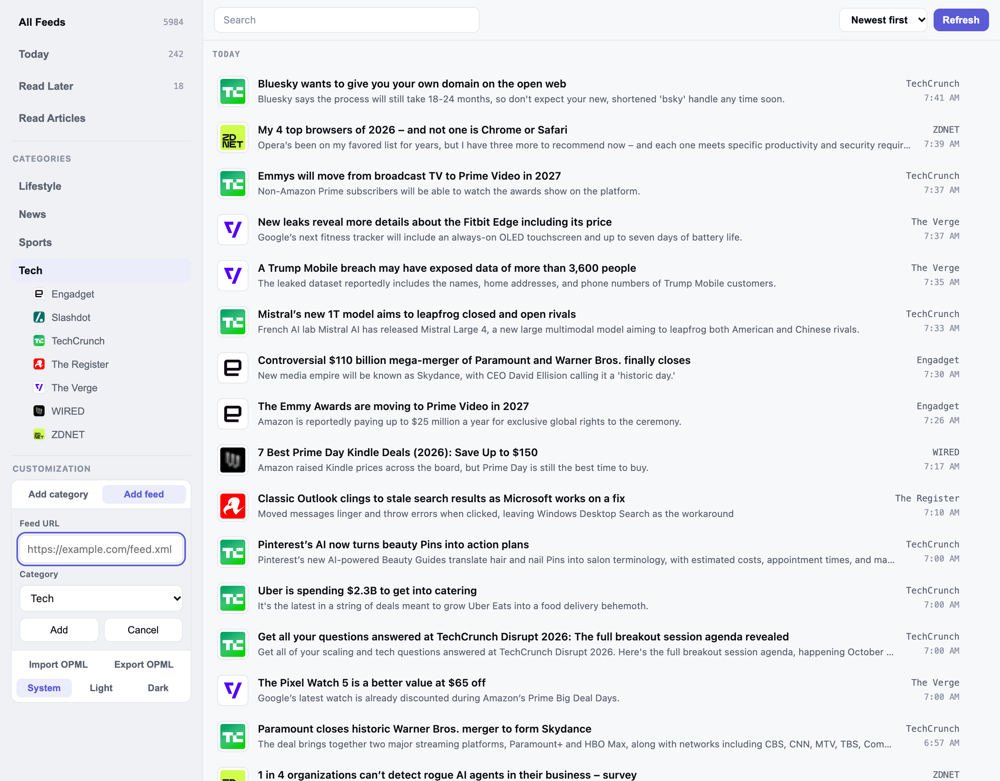
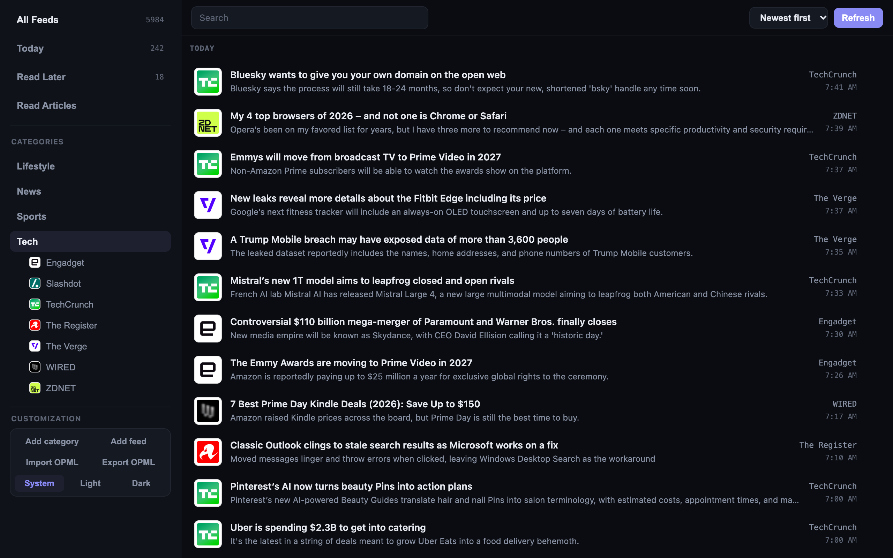
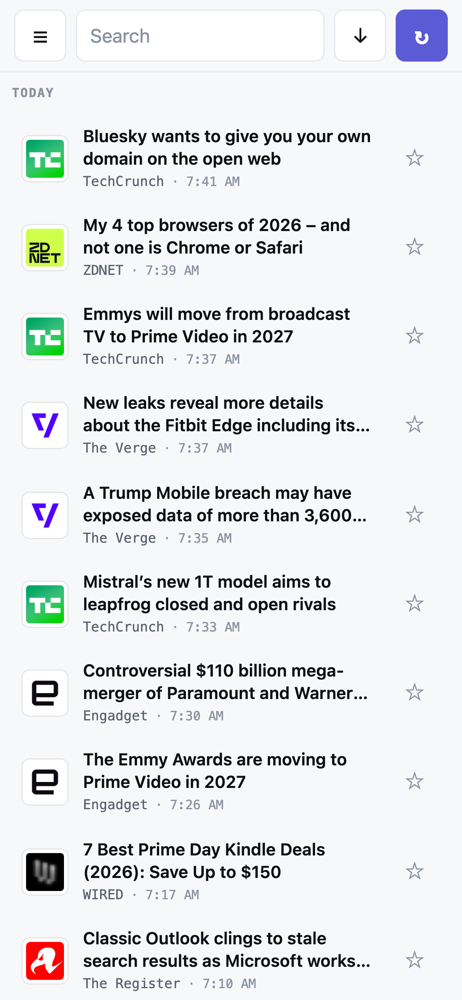
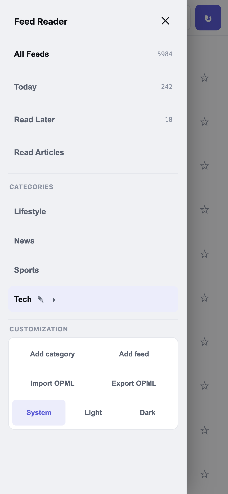

# Feed Reader

A self-hosted, minimal alternative to Feedly. No accounts, no tracking, no third-party services: just an RSS/Atom reader you run yourself, on your own machine or privately on Google Cloud Run.



## Features

- **Categories**: organize subscriptions into categories (drag a feed onto a category to move it). Every feed always belongs to one.
- **Today, Read Later and Read Articles** as sidebar destinations, plus an unread list for any category or feed. Sort newest or oldest first; lists are grouped by date.
- **Search** across all articles by title or description, live as you type, including already-read ones.
- **Real site icons** next to every feed and article, discovered from the site itself and validated, so you get the actual logo instead of a broken image.
- **Light and dark** appearance, following your system by default, with a System / Light / Dark override.
- **Phone-friendly**: a slide-out drawer, touch-sized targets and compact rows.
- **OPML import and export**, so moving to or from another reader is a file away.
- **Your data stays yours**: subscriptions, categories and read/saved state live in a SQLite file owned by the server, outside the code directory, so reinstalling or updating never touches it. Articles are kept for a 30-day retention window (saved ones are kept indefinitely).
- **Auto-refresh** every 15 minutes while the tab is open.

### Screenshots

| Search | Add a feed |
|---|---|
|  |  |

| Dark mode | Mobile | Mobile menu |
|---|---|---|
|  |  |  |

## Tech stack

- **Backend**: Node.js 22+, Express, SQLite (`better-sqlite3`), `rss-parser`
- **Frontend**: React 19, Vite
- **Tests**: Node's built-in test runner (backend)
- **Deployment**: Docker, optionally Google Cloud Run

## Quick start

Requires [Node.js](https://nodejs.org/) 22 or newer.

```bash
git clone <this-repo-url>
cd rss-feed-reader
cd server && npm install
cd ../web && npm install
cd ..
npm start   # builds the frontend, then serves everything on http://localhost:3001
```

Open **http://localhost:3001**. On macOS you can also double-click **`Feed Reader.command`** in the repo root. It starts the app and opens your browser, and closing its window stops the server.

### Development

Run the two dev servers separately so frontend edits hot-reload:

```bash
cd server && npm start     # backend: http://localhost:3001
cd web && npm run dev      # frontend: http://localhost:5173 (proxies /api to the backend)
```

The backend has no hot-reload; restart it after changing anything under `server/src/`.

### Tests and lint

```bash
cd server && npm test      # backend tests
cd web && npm run lint     # frontend lint
```

## Configuration

All settings are optional environment variables.

| Variable | Default | Purpose |
|---|---|---|
| `PORT` | `3001` | Port to listen on |
| `HOST` | `127.0.0.1` | Interface to bind to. Keep the default unless you've put the app behind authentication. |
| `FEED_READER_DATA_DIR` | OS per-app data folder (e.g. `~/Library/Application Support/Feed Reader` on macOS) | Where the SQLite database lives |
| `SQLITE_JOURNAL_MODE` | `WAL` | Use `DELETE` on network or FUSE filesystems |
| `ALLOWED_HOSTS` | loopback only | Comma-separated hostnames allowed in the `Host` header, or `*` |

The app has no login of its own. Don't expose it to a network you don't trust without putting authentication in front of it.

## Project structure

```
server/        Express API, feed fetching/parsing, SQLite, migrations, tests
web/           React + Vite frontend
docs/          Design spec, deployment guide, screenshots
Dockerfile     Single image: API + built frontend
```

## Documentation

- [docs/SPEC.md](docs/SPEC.md): full design and behavior spec (data model, retention rules, design decisions, known gaps)
- [docs/DEPLOY.md](docs/DEPLOY.md): deploying to Google Cloud Run behind Identity-Aware Proxy

## Deploying to Cloud Run

The app can also run as a private Cloud Run service, reachable from your phone or any browser. It's a single instance with the SQLite database on a mounted Cloud Storage bucket, and Identity-Aware Proxy puts Google sign-in in front of it. The `Dockerfile` builds the image; [docs/DEPLOY.md](docs/DEPLOY.md) has the step-by-step commands, environment variables and troubleshooting.

Things that differ from running locally:

- **Never deploy without IAP** (or at minimum `--no-allow-unauthenticated`). Anyone who can reach the app can read and change everything.
- **Personal Gmail accounts need a custom OAuth client for IAP.** The default one only admits members of a Google Workspace/Cloud Identity organization, so you'd see "You don't have access" after signing in. DEPLOY.md covers the fix.
- **Some sites block requests from cloud servers.** One site-specific fallback exists (see `server/src/espnNews.js`); other affected sites show "Blocked by bot protection".
- **Feeds refresh only while the app is open in a browser tab**, same as locally.

## Notes

- Backend business logic (ordering/uniqueness rules, retention purge, guid-fragment dedup, icon-discovery validation) has automated test coverage — see [docs/SPEC.md](docs/SPEC.md)'s Testing section for what each file covers. The frontend doesn't have automated tests yet.
- A refresh occasionally takes a little longer than usual for a given feed — that's the app periodically (about once a month, per feed) re-checking the site's real icon in case it's changed, not a hang or a bug.
- Marking an article read (or un-saving it from Read Later) greys it out immediately but leaves it in place for as long as you keep looking at that same screen — giving you a moment to reconsider before it's gone. It actually disappears once you either hit Refresh (or reload the page), or navigate to a different category/feed/destination and come back. Reloading the page also restores whichever destination/category/feed you were on, unless you close the tab entirely — that resets to the default view (Today).
